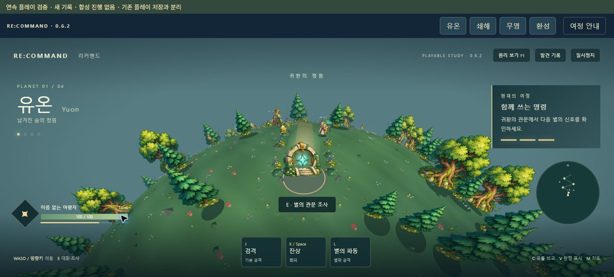
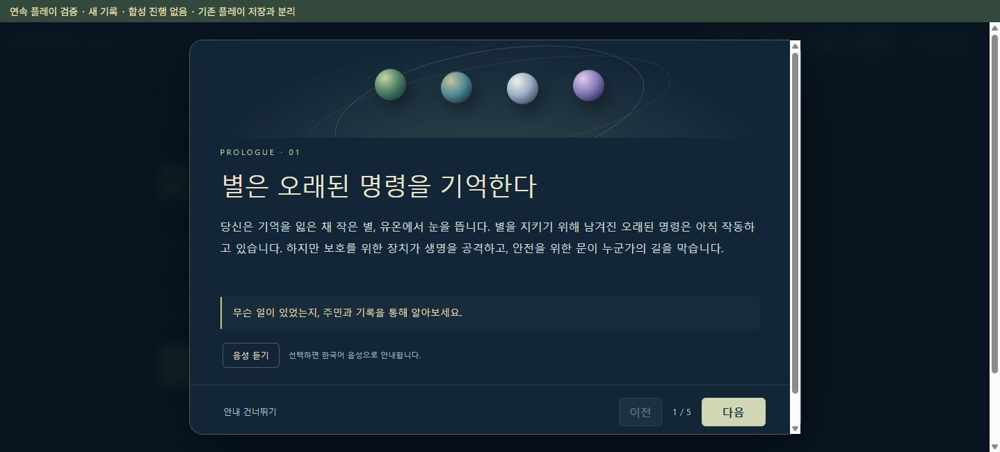

# 🌍 RE:COMMAND · 리커맨드

> 개발판 **v0.6.4-preview.3**: 통합 복원 뒤 이전 화면의 종료 자동 저장이 복원 기록을 덮어쓰는 오류를 수정했습니다. 음악·한국어 안내·네 행성 통합 백업·이름 공개 장면을 포함합니다. 공개 다운로드는 v0.6.3이며, 수정판의 실제 브라우저 재검증과 새 기록의 전체 연속 플레이 검증은 진행 중입니다.

**네 행성을 탐험하고, 오래된 명령을 다시 쓰는 2.5D 액션 어드벤처입니다.**

숲을 보호하던 장치가 생명을 공격합니다. 안전을 지키던 제방은 배의 출항을 막습니다. 기억을 잃은 여행자와 기록자 루미는 별마다 남겨진 명령을 찾아, 지금 살아가는 사람들에게 다시 묻습니다.

전투만으로 끝나지 않습니다. **주민의 말을 듣고, 장치를 직접 살피고, 모은 근거를 바탕으로 명령을 선택하는 게임**입니다.

- 현재 버전: **v0.6.3 · 플레이 가능한 개발판**
- 실행 환경: PC의 Chrome / Edge, 키보드 조작
- 사용 기술: JavaScript · HTML · CSS · WebGL · Canvas 2D
- 배포 형태: 설치 없이 여는 **통합 HTML 파일 하나**
- 구현 범위: 네 행성의 탐험·전투·선택과 결말. 새 기록의 전체 연속 플레이 검증은 진행 중

---

<a id="download"></a>

## 📥 바로 다운로드하고 플레이하기

1. **[최신 Releases 페이지](https://github.com/planetcreat/RECOMMAND/releases/latest)**의 Assets에서 **`PLAY-RECOMMAND.html`**을 다운로드합니다.
2. 다운로드한 파일을 **Chrome 또는 Edge**로 엽니다. 연결 앱이 다르면 파일을 우클릭하고 브라우저를 선택하세요.
3. **유온**을 선택하고 짧은 프롤로그를 읽은 뒤 **첫 번째 별에 내려서기**를 누릅니다.
4. 화면 오른쪽의 현재 목표를 따라, 가까이 있는 루미에게 다가가 **E**로 대화하세요.

**게임을 플레이하는 데 Node.js 설치나 소스 코드 다운로드는 필요하지 않습니다.** 통합 HTML 하나에 네 행성의 코드·화면·이미지가 들어 있습니다. 게임 본편은 외부 이미지나 라이브러리를 받아오지 않습니다.

GitHub에서 HTML 파일을 눌러 보이는 소스 화면은 게임 실행 화면이 아닙니다. 파일을 다운로드하고 브라우저로 열어 주세요. 채팅 앱이나 문서 앱의 미리보기에서는 스크립트가 실행되지 않을 수 있습니다.

### 서버 없이 개발판을 먼저 열어보기

**[v0.6.4-preview.2 웹 실행](https://raw.githack.com/planetcreat/RECOMMAND/fd99d6d7ff7ac47458a5822f36521a317428ee12/release/PLAY-RECOMMAND.html)** — 설치나 로컬 서버 실행 없이 Chrome에서 엽니다. 공개 GitHub의 특정 커밋을 제공하는 외부 미리보기이며, 기존 Sites 주소와는 별개입니다. `External Content Notice`가 나오면 표시된 저장소와 파일을 확인한 뒤 `Open the page`를 선택하세요.

웹 실행은 인터넷 연결이 필요하며 외부 서비스의 가용성에 영향을 받습니다. 오프라인 플레이는 위의 Releases 파일을 사용하세요. 웹 주소와 다운로드한 HTML의 저장 공간은 별개이므로, 기존 진행을 옮길 때는 **진행 보관 → 전체 기록 내보내기 → 대상 실행판에서 파일 선택·미리보기·복원** 순서로 이동합니다. 처음부터 다시 시작할 필요는 없습니다.

이 링크는 이전 preview.2 실행판입니다. 실행 중인 행성의 기록을 복원하면 이전 화면의 종료 자동 저장이 이를 덮어쓸 수 있는 오류가 확인됐습니다. 이 링크에서는 통합 백업 내보내기를 사용하고 복원·되돌리기 적용은 수정판 안내를 기다려 주세요. 이름 공개 장면을 포함한 전체 연속 완주와 음질·음량 균형 검증도 남아 있습니다.

### 어떤 파일을 받으면 되나요?

| 파일 | 용도 |
| --- | --- |
| **`PLAY-RECOMMAND.html`** | **추천.** 네 행성을 한 파일에서 플레이. 프롤로그·행성별 안내·다시보기를 포함합니다. |
| `release/RECOMMAND.html` | 유온 개별 실행판. |
| `release/SWAEHAE.html` | 쇄해 개별 실행판. |
| `release/MUMYEONG.html` | 무명 개별 실행판. |
| `release/HWANSEONG.html` | 환성 개별 실행판. |

개별 실행판으로 행성을 이동하려면 네 HTML을 같은 폴더에 두어야 합니다. 처음 플레이한다면 통합판을 사용하세요. 소스 폴더의 `dist/index.html`을 직접 더블클릭하는 방식은 지원하지 않습니다.

---

## 📌 목차

1. [게임 방법과 조작법](#play)
2. [이야기와 네 행성](#story)
3. [주요 기능](#features)
4. [화면 구성](#screen)
5. [프롤로그와 음성 안내](#prologue)
6. [저장과 이어하기](#save)
7. [실행이 잘 안 될 때](#help)
8. [소리는 어떻게 만들었나](#sound)
9. [그래픽은 어떻게 그렸나](#graphics)
10. [게임이 돌아가는 원리](#runtime)
11. [프로젝트 구조와 소스 실행](#source)
12. [개발 환경](#environment)
13. [개발 및 검증 상태](#status)

---

<a id="play"></a>

## 🎮 게임 방법과 조작법

RE:COMMAND의 중심은 **관찰을 통해 판단의 근거를 얻는 것**입니다. 주민의 말과 장치의 반응을 살피고, 보스의 공격 규칙을 파악하고, 전투 이후 남은 명령을 어떻게 바꿀지 선택합니다.

- **휘어진 세계:** 논리적인 이동은 평면에서 처리하고, 화면에는 지면을 둥글게 휘어 그립니다. 나무와 환경 장식은 지면의 방향을 따라 기울어집니다.
- **2D와 3D의 조합:** 캐릭터와 환경 그림은 스프라이트, 보스는 입체 메시로 표현합니다.
- **직접 조작하는 전투:** 가까이서 방향을 맞춰 검격을 사용하고, 파동·회피로 위험에 대응합니다.
- **여정에 남는 선택:** 앞선 행성에서 한 행동과 선택이 뒤의 대화와 반응에 영향을 줍니다.
- **다시 살필 수 있는 기록:** 발견한 내용을 다시 읽고, 모은 근거를 바탕으로 판단합니다. 선택 가능한 대안과 숨은 사건도 있습니다.

온라인 계정·멀티플레이·외부 서버 저장을 사용하지 않는 싱글플레이 개발판입니다.

### 키보드 조작

| 입력 | 동작 |
| --- | --- |
| **WASD / 방향키** | 이동. |
| **E** | 가까운 주민과 대화, 장치·기록 조사, 대화 계속. |
| **Enter** | 대화 계속. 선택지가 있으면 버튼을 선택하세요. |
| **J** | 바라보는 방향으로 가까운 적에게 검격. |
| **L** | 주변에 파동 공격. 재사용 시간이 있습니다. |
| **K / Space** | 회피. 전투와 행성에 따라 사용할 수 있는 구간이 다릅니다. |
| **Esc / 일시정지 버튼** | 일시정지·재개. 열린 대화 등 화면 상태에 따라 동작합니다. |
| **M** | 지도가 있는 탐험 화면에서 지도 표시 전환·확대. |
| **발견 기록** | 이미 발견한 대화와 기록 확인. |

유온의 **F1 원리 보기**, **C 곡률 비교**, **V 판정 표시**는 렌더링과 전투 판정을 살펴보는 개발용 기능입니다. 일반 플레이에 필수는 아닙니다.

전투의 붉은 범위는 공격 예고입니다. 검격이 닿지 않으면 상대를 바라보고 조금 더 접근하세요. 공격과 파동에는 재사용 시간이 있으며, 보스마다 빈틈이 열리는 방식이 다릅니다.

---

<a id="story"></a>

## 🪐 이야기와 네 행성

당신은 이름도 과거도 기억하지 못합니다. 숲의 기록자 **루미**는 길을 안내하지만, 모든 답을 알고 있지는 않습니다. 여행이 이어질수록 별에 남은 기록과 두 사람의 관계가 조금씩 달라집니다.

아래 설명은 처음 진행할 때 필요한 정보입니다. 결말과 숨은 선택의 조건은 적지 않았습니다.

| 순서 | 행성 | 그곳의 문제 | 플레이의 중심 | 처음 할 일 |
| --- | --- | --- | --- | --- |
| 01 | **유온 · 남겨진 숨의 정원** | 숲을 지키던 수호 장치가 생명을 공격합니다. | 주민의 이야기와 숲에 남은 흔적 탐험. | 루미에게 다가가 E로 대화하기. |
| 02 | **쇄해 · 닫힌 길의 바다** | 제방은 안전하지만 물길과 출항이 막혔습니다. | 수문 조작, 수압 관찰, 물길 실험과 문지기 전투. | 제방지기 나루와 대화하기. |
| 03 | **무명 · 지워진 이름의 설원** | 이름이 지워진 마을에 서로 다른 기억이 남았습니다. | 주민의 증언을 듣고 과거 장면을 대조하기. | 시온을 만나 증언과 기록 모으기. |
| 04 | **환성 · 돌아온 목소리의 궤도** | 지나온 선택에 대한 응답이 돌아옵니다. | 세 반응 시험, 실제 신호 관찰과 마지막 선택. | 통신환을 조사해 반응 시험 시작하기. |

### 진행이 막혔을 때

1. **오른쪽 현재 목표**와 지도에서 다음 장소를 확인합니다.
2. 사람이나 장치에 가까이 가서 **E**를 누릅니다. 전투에서 승리한 뒤에도 **남은 기록이나 명령 장치의 조사**가 필요합니다.
3. 발견 기록을 다시 읽습니다. 같은 장치를 조건이 달라진 뒤 조사하면 다른 반응이 나올 수 있습니다.
4. 그 별의 결말을 마치고 다음 행성으로 이동합니다. 유온에서는 시작 지점의 귀환 관문, 쇄해에서는 **무명으로 출발** 버튼을 이용하세요.

길 밖의 단서를 모두 찾지 않아도 기본 이야기를 진행할 수 있습니다. 숨은 조건을 충족하지 않았다고 전체 진행이 막히지는 않습니다.

---

<a id="features"></a>

## ✨ 주요 기능

### 1. 말을 듣고 직접 확인하는 탐험

주민과 대화하거나 장치를 조사할 때는 가까이에서 **E**를 누릅니다. 행성마다 필요한 행동이 다릅니다. 유온에서는 제단을 복구하고, 쇄해에서는 수문의 조합을 바꾸며 물길을 관찰합니다. 무명에서는 증언과 장면을 비교하고, 환성에서는 이전 선택의 반응을 살핍니다.

찾은 내용은 **발견 기록**에서 다시 읽을 수 있습니다. 같은 대화를 반복한다고 단서가 중복으로 쌓이지는 않습니다.

### 2. 방향과 거리를 사용하는 전투

검격은 **가까운 적을 바라볼 때** 맞습니다. 멀리서 J만 누르면 닿지 않습니다. L 파동은 주변의 적을 공격하며, K / Space 회피로 공격 범위를 벗어날 수 있습니다. 공격과 회피는 각각 재사용 시간이 있습니다.

보스마다 행동과 위험의 의미가 다릅니다. 주민이 알고 있는 이야기와 탐험 중의 발견이 대응을 생각할 근거가 됩니다. **구체적인 패턴 정보는 게임 속 히든 퀘스트와 관찰로 알아내는 내용**이므로 시작 안내나 README에서 설명하지 않습니다.

### 3. 주민의 의사를 남기는 선택

보스를 이긴 뒤에도 그 자리에 남은 기록이나 명령 장치를 조사해야 합니다. 무엇이 이 별을 막았는지 읽은 다음, 남길 명령을 선택합니다.

기본 경로 외에 숨은 사건과 대안 선택도 있습니다. 단서는 선택할 이유를 마련해 주며, 필요한 근거를 모으지 않았다면 해당 선택지가 처음부터 보이지 않는 경우도 있습니다. 숨은 사건을 전부 찾지 않아도 기본 이야기를 끝낼 수 있습니다.

### 4. 앞선 행성의 선택이 돌아오는 구조

환성의 반응은 앞선 행성의 실제 저장 기록을 참고합니다. 방문하지 않은 별의 결과를 임의로 완료한 것으로 만들지 않습니다. 이전 기록이 없는 주소에서 시작하면 그 상태에 맞춰 안내합니다.

### 5. 다시 시도할 수 있는 진행

전투에서 패배해도 이미 얻은 이야기와 발견을 처음부터 다시 모으도록 만들지 않았습니다. 복귀 지점과 전투 재시도 방식은 행성에 따라 다릅니다. 선택을 다시 검토하거나 기록을 재열람할 수 있는 구간도 있습니다.

### 6. 한 파일에 담은 네 행성

통합판은 HTML·스크립트·스타일·이미지를 모두 내장합니다. 공유 이미지 아틀라스 세 개는 한 번씩만 포함해 중복을 줄였습니다. 인터넷으로 별도 그림을 불러오지 않아도 본편을 실행할 수 있습니다. 오디오 개발판은 안내 음원도 파일 안에 내장하며, 음악은 별도 다운로드 없이 연주합니다.

---

<a id="screen"></a>

## 🖥 화면 구성



| 위치 | 보여 주는 것 | 이렇게 활용하세요 |
| --- | --- | --- |
| 화면 위 | 행성 이동, 여정 안내, 발견 기록, 일시정지 | 현재 별의 안내를 다시 읽거나 진행을 멈춥니다. |
| 왼쪽 | 현재 행성의 이름과 부제 | 지금 어느 구간을 플레이하는지 확인합니다. |
| 오른쪽 목표 패널 | 현재 임무와 진행 단계 | 다음에 해야 할 행동을 확인합니다. |
| 아래 체력 표시 | 여행자의 체력·성장 정보 또는 전투 상태 | 전투 중 남은 체력을 확인합니다. |
| 아래 조작 영역 | 공격·회피·파동과 사용 가능 상태 | 사용 중인 기술과 재사용 대기를 확인합니다. |
| 지도 | 주요 장소와 현재 위치 | 길을 잃었을 때 다음 장소의 방향을 찾습니다. 지도 위치는 행성별로 다릅니다. |
| 중앙 대화창 | 인물의 말, 장치 기록, 선택지 | 계속 버튼으로 읽고, 선택지가 나오면 직접 결정합니다. |

유온 보스를 쓰러뜨린 자리에는 **빛나는 원과 ‘수호자의 기억’ 표식**이 남습니다. 보스가 처음 위치에서 이동했더라도 실제 처치 위치에서 E로 조사할 수 있습니다.

---

<a id="prologue"></a>

## 🎙 프롤로그와 음성 안내



통합판은 처음 진입할 때 이야기의 배경과 기본 진행 방식을 짧게 보여 줍니다. 행성을 처음 넘어갈 때도 그곳의 상황과 첫 목표를 안내합니다.

| 기능 | 사용 방법 |
| --- | --- |
| 다음 / 이전 | 자신의 속도로 안내를 읽습니다. 자동으로 넘어가지 않습니다. |
| 안내 건너뛰기 | 바로 해당 행성의 게임 화면으로 갑니다. 진행 조건이나 보상에는 영향이 없습니다. |
| 여정 안내 | 화면 위 버튼으로 배경과 현재 행성의 안내를 다시 봅니다. 게임을 새로 시작하지 않습니다. |
| 음성 듣기 | 오디오 개발판에서 프롤로그 3장면과 네 행성의 첫 소개를 내장 MP3로 들을 수 있습니다. 기본값은 꺼짐입니다. |

연출은 움직이는 화면 장식과 장면별 글 안내입니다. 오디오 개발판에서는 브라우저 기본 음성 대신 TTSMaker로 미리 생성한 한국어 나레이션을 사용합니다. 장면을 넘기거나 안내를 닫으면 음성이 멈춥니다. 추가 안내 네 장면은 글로만 제공하며, 재생에 실패해도 글로 계속할 수 있습니다.

---

<a id="save"></a>

## 💾 저장과 이어하기

진행은 **현재 브라우저의 로컬 저장소**에 행성별로 자동 저장됩니다. 다음에 같은 브라우저·프로필·주소에서 열고 해당 행성의 **기억 이어가기**를 선택하세요. 쇄해는 저장된 항구 진행을 자동으로 불러옵니다.

**주의: 다른 웹 주소, 브라우저, 프로필 또는 파일 위치로 옮기면 같은 저장으로 인식되지 않을 수 있습니다.** HTML 파일 안에 당신의 저장이 들어가는 방식은 아닙니다. 시크릿 모드 종료나 사이트 데이터 삭제로 기록이 사라질 수도 있습니다.

| 구간 | 현재 제공하는 보관 기능 |
| --- | --- |
| 유온 | 원리 보기 안의 진행 내보내기·가져오기. |
| 쇄해 | 같은 주소의 브라우저 자동 저장. 개발판 통합 진행 보관에서 파일로 내보내고 복원할 수 있습니다. |
| 무명·환성 | **진행 보관**에서 해당 행성의 내보내기·가져오기. |
| 네 행성 전체 | 개발판 위쪽 **진행 보관**에서 통합 JSON 백업·확인 후 복원·직전 복원 되돌리기를 제공합니다. |

개발판의 통합 복원은 파일을 고르는 것만으로 저장을 바꾸지 않습니다. 행성별 기록 유무를 확인하고 **확인한 기록으로 복원**을 눌러야 적용됩니다. 파일에 없는 행성의 현재 기록은 유지합니다. 손상된 주 기록 대신 유효한 이전 자동 저장을 쓰는 경우 확인 화면에 표시합니다. 저장소 쓰기가 중단되면 복원 전 기록으로 되돌리며, 되돌리기마저 중단되면 다음 실행에서 먼저 복구합니다. 파일을 내보내기 전에 현재 행성의 저장을 확인하므로 시작 지연·저장 실패 상태에서는 먼저 해당 문제를 확인해 주세요.

불러오기 실패만으로 기존 기록을 지우지 않습니다. 손상된 저장은 검증하며, 가능한 경우 백업 기록을 사용합니다. **문제가 생겼다고 바로 초기화하거나 사이트 데이터를 삭제하지 마세요.** 먼저 원래 플레이한 주소·브라우저인지 확인하세요.

---

<a id="help"></a>

## 🔎 실행이 잘 안 될 때

| 증상 | 확인할 것 |
| --- | --- |
| 코드만 보이거나 미리보기에서 움직이지 않음 | GitHub·채팅 미리보기를 닫고, 다운로드한 HTML을 Chrome/Edge로 직접 열어 주세요. |
| `불러오기 실패` 또는 시작 지연 표시 | 화면에 적힌 오류를 확인하고 다시 열기를 시도하세요. 파일 다운로드가 끝났는지, 확장자가 `.html`인지 확인하세요. |
| 이전 진행이 보이지 않음 | 같은 브라우저·프로필·주소인지 확인하세요. 통합판과 개별 파일, 서로 다른 서버 주소의 저장은 자동으로 합쳐지지 않습니다. |
| 소스의 `dist/index.html`을 더블클릭했더니 실패 | 플레이용 `PLAY-RECOMMAND.html`을 사용하거나 아래 개발 서버 실행 방법을 따르세요. |
| 화면이 느림 | 다른 무거운 탭을 줄이고 브라우저의 그래픽 가속 상태를 확인하세요. WebGL을 사용할 수 없으면 느린 CPU 호환 렌더러로 전환될 수 있습니다. |
| 키가 반응하지 않음 | 게임 화면 안을 클릭하고, 일시정지·대화·안내 창이 열려 있는지 확인하세요. |
| 음성 듣기를 사용할 수 없음 | 개발판의 보조 안내는 글로만 제공됩니다. 음성이 있는 핵심 장면에서도 재생이 막히면 글로 계속할 수 있습니다. 공개 v0.6.3은 브라우저 한국어 음성 지원이 필요합니다. |

---

<a id="sound"></a>

## 🔊 소리는 어떻게 만들었나

현재 유온의 기본 효과음은 MP3나 WAV를 읽는 대신, 브라우저의 **Web Audio API**로 간단한 파형을 만들어 재생합니다. 검격·파동·회피·피격의 음 높이와 길이를 다르게 두어 행동을 구분합니다.

오디오 개발판의 한국어 안내는 TTSMaker 준혁 음성으로 미리 생성한 MP3입니다. 게임을 시작할 때 외부 TTS 서비스에 접속하지 않으며 API 키도 필요하지 않습니다. 나레이션이 나오는 동안 음악은 작아지고, 음성이 끝나거나 안내를 닫으면 원래 음량으로 돌아옵니다.

오디오 개발판의 오른쪽 위 **배경음악** 메뉴에서 음악 켜기·끄기와 음량을 조절합니다. 기본은 꺼짐이며, 행성 이동 시 곡이 부드럽게 전환됩니다. 음악 설정은 진행 기록과 따로 보관됩니다.

| 행성 | 곡 | 분위기 |
| --- | --- | --- |
| 유온 | 남겨진 숨 | 따뜻한 화음과 부드러운 선율 |
| 쇄해 | 닻 아래의 물결 | 느린 흐름과 반복되는 물결 |
| 무명 | 눈에 남은 이름 | 여백이 많은 높은 음과 조용한 화음 |
| 환성 | 대답이 닿는 궤도 | 넓은 음역과 돌아오는 선율 |

음악 네 곡은 이 프로젝트에서 구성한 오리지널 연주 데이터로 Web Audio API가 재생합니다. 개별 행성 HTML의 음악, 보스전 음악과 전 행성 효과음 통일은 후속 작업입니다. 내장 음성의 제공처와 권한은 [오디오 안내](docs/AUDIO.md)에 정리했습니다.

---

<a id="graphics"></a>

## 🎨 그래픽은 어떻게 그렸나

### 캐릭터와 환경 그림

캐릭터·일반 적·나무·장식은 **이미지 아틀라스**를 잘라 사용하는 2D 스프라이트입니다. 아틀라스는 여러 그림을 한 장에 묶은 이미지입니다. 캐릭터, 환경, 전투 효과용 세 묶음을 사용합니다.

준비한 이미지와 코드로 만든 3D 형태를 함께 사용합니다. 이미지가 준비되지 않거나 GPU에 올리지 못하면 가능한 범위에서 기본 도형 그림으로 대체합니다.

### 보스와 공격 표현

보스는 실제 3D 메시로 만들었습니다. 둥근 몸체와 관절을 조합하고, 호흡·공격 준비·회복 자세를 시간에 따라 보간합니다. 검격 리본·파동·파편 같은 효과는 월드 공간에서 그리고, 바닥 예고 범위로 공격 위치를 알려 줍니다.

### 둥글게 휘는 행성

지면은 카메라 중심에서 멀어질수록 화면 아래로 내려가도록 그립니다. 나무의 뿌리는 그 지면에 놓고, 줄기는 **그 자리에 있는 지면에 수직인 방향**으로 세웁니다. 그래서 행성 가장자리의 나무가 화면 전체에 똑같이 수직으로 서 있지 않고 바깥쪽으로 기울어집니다.

이 휨은 화면 표현입니다. 캐릭터의 이동·충돌·공격 사거리 계산은 기존의 평면 좌표를 유지합니다. 실제 구형 행성의 중력이나 궤도 물리를 계산하는 게임은 아닙니다.

### 두 가지 렌더러

| 방식 | 역할 |
| --- | --- |
| **WebGL** | GPU로 메시·이미지·깊이를 처리하는 기본 렌더러. |
| **Canvas 2D CPU 호환 경로** | WebGL을 사용할 수 없을 때 화면을 CPU에서 투영해 그리는 대체 렌더러. 상세도와 성능이 다를 수 있습니다. |

별도의 Three.js 같은 외부 3D 라이브러리 없이 렌더링 코드를 구성했습니다.

---

<a id="runtime"></a>

## ⚙ 게임이 돌아가는 원리

게임은 **상태 계산**과 **화면 표시**를 구분합니다.

1. 키보드와 화면 버튼의 입력을 읽습니다.
2. 일정한 시간 간격으로 이동·충돌·기술 대기 시간·적의 행동·퀘스트 상태를 계산합니다.
3. 직전 위치와 현재 위치 사이를 보간해 캐릭터를 표시합니다.
4. 카메라를 경과 시간에 따라 부드럽게 이동시키고, 휘어진 지면·물체·효과·화면 안내를 그립니다.
5. 필요한 시점에 행성별 진행을 자동 저장합니다.

상태 계산은 기본적으로 **1/60초 단위**입니다. 화면은 브라우저의 그리기 주기에 맞춰 갱신하므로 ‘항상 60FPS가 나온다’는 뜻은 아닙니다. 30Hz와 144Hz 화면에서도 카메라의 따라오는 속도가 달라지지 않도록 시간 기반 보정을 사용합니다.

**신경 쓴 부분**

- 표시 위치를 부드럽게 바꿔도 실제 충돌 좌표나 공격 대기 시간을 바꾸지 않습니다.
- 대화·일시정지 중에는 진행과 전투를 멈추고, 창 전환 시 눌린 입력을 정리합니다.
- 저장을 읽을 때 형식과 진행의 모순을 검사합니다. 잘못된 파일을 읽었다고 현재 기록을 바로 초기화하지 않습니다.
- 행성 안내의 열람 여부는 게임 진행과 별도 기록으로 둡니다. 안내 건너뛰기로 퀘스트가 완료되지는 않습니다.
- 이미지·음성·저장 기능의 실패가 가능한 한 본편 시작을 막지 않도록 대체 경로와 안내를 둡니다.

---

<a id="source"></a>

## 📁 프로젝트 구조와 소스 실행

Node.js 20 이상이 필요합니다. 외부 패키지 설치 없이 실행할 수 있습니다.

```sh
node server.mjs
```

브라우저에서 **http://127.0.0.1:4173/play**를 열면 통합판, **http://127.0.0.1:4173/**를 열면 모듈형 유온을 실행합니다.

```sh
# 네 행성 HTML과 통합 실행판 다시 만들기
node build-chapters.mjs
node build-standalone.mjs
node build-launcher.mjs

# 게임 내 학습 패널에서 제공할 소스 ZIP 만들기
node build-source.mjs

# 자동 검사
node --test tests/*.test.mjs
```

### 코드와 문서 찾기

| 경로 | 내용 |
| --- | --- |
| `dist/game.js` | 유온의 탐험·전투·진행. |
| `dist/swaehae.js`, `tide.js`, `belrok.js` | 쇄해의 수문·항해·보스. |
| `dist/late-*.js` | 무명·환성의 이야기·진행·전투·보스. |
| `dist/engine.js`, `software.js`, `math.js` | GPU/CPU 렌더링, 곡면 방향, 이동과 표시 계산. |
| `dist/briefing.js`, `launcher.js`, `launcher.css` | 통합판의 이야기 안내와 화면 전환. |
| `release/` | 실제 배포할 HTML 실행판. |
| `tests/` | 자동 검사와 별도 브라우저 검증용 서버. |
| [VERIFICATION.md](VERIFICATION.md) | **제작자용 스포일러 포함.** 실제 확인한 경로와 검증의 한계. |
| [VISUAL-GUIDE.md](VISUAL-GUIDE.md) | 그래픽 자산과 표현 방향. |
| [STORY.md](STORY.md), [ENDING-SCENE.md](ENDING-SCENE.md) | **제작자용 스포일러 포함.** 이야기 설계와 최종장 대본. |

브라우저 검증 서버는 실제 플레이 주소와 분리됩니다. `node tests/browser-journey-qa.mjs`의 **4182**는 빈 저장에서 직접 플레이하는 용도이며 진행을 만들어 넣지 않습니다. `node tests/browser-shared-qa.mjs`의 **4181**은 명시적 버튼으로 합성 저장을 넣어 공동 결말을 점검하는 용도입니다. 두 검증을 혼동하지 않도록 화면에 표시합니다.

---

<a id="environment"></a>

## 🛠 개발 환경

| 항목 | 내용 |
| --- | --- |
| 실행 대상 | 키보드가 있는 PC의 Chrome / Edge |
| 언어 | JavaScript ES Modules, HTML, CSS |
| 기본 그래픽 | WebGL |
| 호환 그래픽 | Canvas 2D CPU 투영 |
| 기본 효과음 | Web Audio API — 현재 유온의 기본 효과음 |
| 선택형 안내 음성 | 개발판: 내장 MP3 / 공개 v0.6.3: Web Speech API |
| 소스 실행·빌드·검사 | Node.js 20 이상, 외부 패키지 설치 불필요 |
| 배포 파일 | 코드·스타일·그림이 내장된 단일 HTML |
| 실제 검증 환경 | Windows의 Chrome 확장 연결. Edge와 다양한 PC의 추가 점검은 진행 예정 |

스마트폰 터치 전용 조작과 게임패드 지원은 정식 지원 범위로 검증하지 않았습니다.

---

<a id="status"></a>

## 🧪 개발 및 검증 상태

### 구현한 것

- 네 행성의 탐험·대화·기록·보스·선택과 결말.
- 세 이미지 아틀라스를 중복 없이 내장한 네 행성 통합 실행판.
- 고정 시간 간격의 이동 처리, 표시 위치 보간, 시간 기반 카메라 추적.
- 곡면의 지면 방향을 따르는 환경 장식과 3D 메시. WebGL·CPU 호환 경로에 적용.
- 처음 시작하는 사람을 위한 프롤로그와 행성별 진행 안내.
- 이동한 유온 보스의 실제 처치 위치에서 기억을 조사하고 다시 불러올 수 있는 표식.

### 검증한 것과 아직 남은 것

| 구분 | 상태 |
| --- | --- |
| 자동 검사 | **개발판 110개 통과.** 통합 복원 실패·중단 복구·이름 공개 순서 검사를 포함합니다. 공개 v0.6.3은 86개 통과. 전투·저장·분기·렌더링 계산·통합판·프롤로그·공개 안내의 공략 정보 제외와 실제 대사의 정보 획득 조건을 검사합니다. |
| 실제 Chrome | 네 행성 실행과 입력, 무명·환성 보스와 결말 경로를 검증했습니다. |
| 새 기록 연속 플레이 | 별도 주소에서 합성 진행 없이 **유온 완료 → 쇄해 진입**까지 확인했습니다. 이후 연속 검증은 진행 중입니다. |
| 공동 결말 전체 연출 | 별도 주소의 합성 저장으로 14장면과 새로고침 후 완료 상태 유지를 확인했습니다. 네 행성 연속 완주 검증과는 구분합니다. |
| 캐릭터 애니메이션 | 기존 앞뒤 각 2프레임에 표시 보간·걸음·회피 자세 보정을 적용했습니다. 새 프레임 확장은 미완료입니다. |
| 배포 환경 | Chrome에서 검증 중입니다. 다양한 PC·Edge·장시간 저성능 환경의 점검은 남아 있습니다. |

v0.6.3은 쇄해의 기존 필수 대사와 일반 대화에서도 미리 공략 정보를 설명하지 않도록 정리한 대사 패치입니다. 정보 획득 조건과 기존 저장은 유지합니다. 이 패치의 새 브라우저 연속 플레이 검증은 개발 환경의 실행 차단으로 보류 중이며, 완료한 것으로 표시하지 않습니다.

애니메이션 프레임 확장과 최종 움직임 다듬기, 사운드·후반 환경 연출, 난이도 조정과 전체 연속 플레이 검증이 남아 있습니다. 개발판의 통합 저장과 새 이야기 장면도 실제 입력으로 확인해야 합니다.
